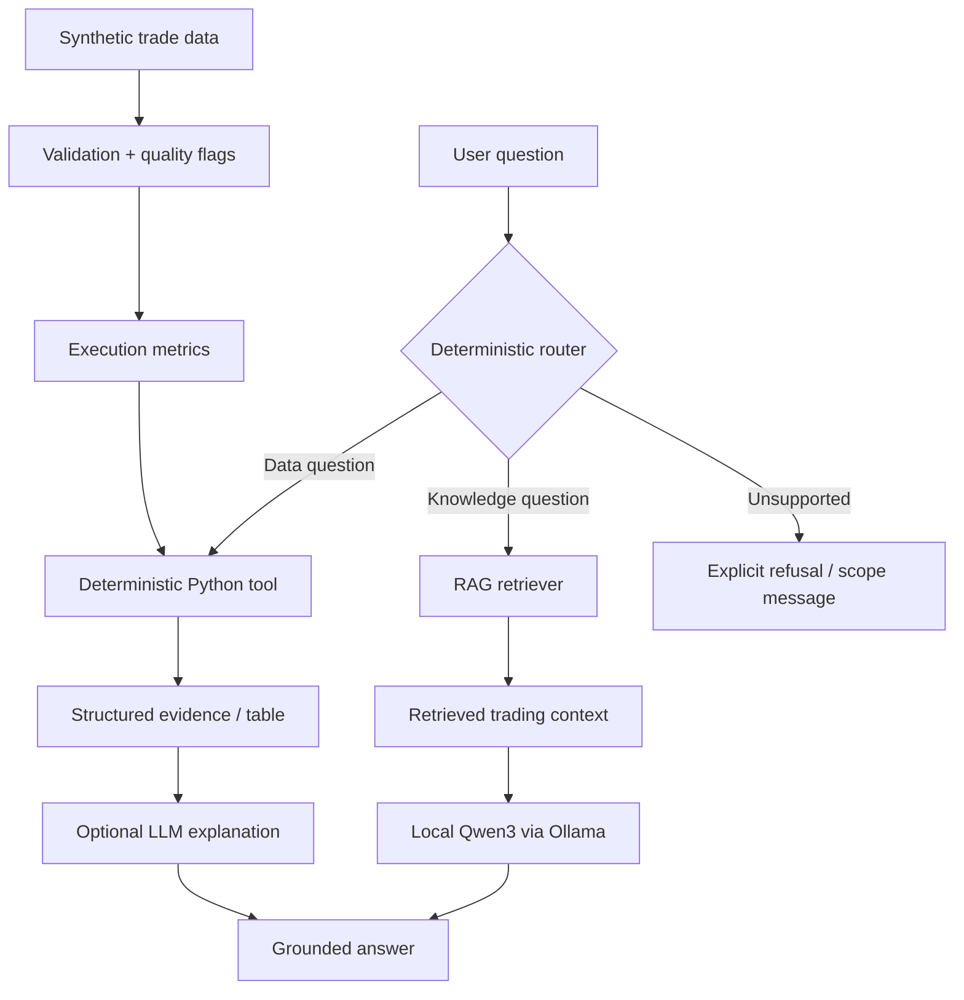

# Trading Execution Decision-Support Prototype

A small, auditable prototype that combines **deterministic trading-execution analytics**, **data-quality controls**, **grounded RAG**, and a **routing workflow** over a deliberately imperfect synthetic dataset.

> **Scope:** Technical demonstration prototype only. The data are synthetic, the metrics are simplified, and this is **not** a production transaction-cost-analysis (TCA) model, execution algorithm, investment recommendation, or representation of any employer's methodology.

## Why this project

The project is designed around a practical question:

> **Where should an LLM help, and where should deterministic code remain in control?**

- Numerical execution metrics are calculated in Python.
- Data-quality constraints are explicit and testable.
- Domain-definition questions use RAG over a small trading knowledge base.
- Unsupported questions are routed out rather than forcing a retrieval answer.
- The LLM is used only for grounded explanation or bounded drafting, not for arithmetic or record-level truth.

That separation makes the system easier to inspect, test and discuss than a monolithic chatbot.

## Architecture



## Implemented components

1. **Synthetic trading-data modelling** with reproducibility and deliberately injected edge cases.
2. **Data-quality controls** for duplicates, missing benchmarks, invalid quantities and dirty categories.
3. **Side-adjusted execution metrics** so adverse BUY and SELL executions have a consistent sign.
4. **Analysis-ready universes** that separate hard data errors from legitimate but unusual outcomes such as partial fills.
5. **Execution analytics** by venue and asset class, plus worst-execution and partial-fill views.
6. **Grounded RAG** over execution-cost, liquidity and execution-risk notes.
7. **Workflow routing** between knowledge retrieval, structured analytics and unsupported questions.
8. **Component-level evaluation** of routing, data-quality detection, numeric logic and retrieval behaviour.
9. **Markets data-governance controls** using Critical Data Attributes, thresholds, issue management and lineage.
10. **Bounded AI-assisted governance drafting** with deterministic validation, regression evaluation and human review.

## Repository structure

```text
.
├── data/
│   └── synthetic_trades.csv
├── docs/
│   ├── cda_registry.csv
│   └── data_lineage.md
├── evals/
│   ├── governance_ai_cases.csv
│   └── governance_ai_evaluation.csv
├── knowledge/
│   ├── execution_cost_notes.txt
│   ├── execution_risk_notes.txt
│   ├── liquidity_notes.txt
│   └── SOURCES.md
├── notebooks/
│   └── trading_execution_demo.ipynb
├── outputs/
│   ├── asset_class_summary.csv
│   ├── data_quality_summary.csv
│   ├── evaluation_report.md
│   ├── governance_issue_register.csv
│   ├── governance_quality_report.csv
│   └── venue_summary.csv
├── src/trading_ai/
│   ├── analytics.py
│   ├── cli.py
│   ├── config.py
│   ├── evaluation.py
│   ├── governance.py
│   ├── governance_ai.py
│   ├── llm.py
│   ├── metrics.py
│   ├── rag.py
│   ├── router.py
│   ├── synthetic_data.py
│   ├── validation.py
│   └── workflow.py
└── tests/
    ├── test_governance.py
    └── test_governance_ai.py
```

## Synthetic data and deliberate traps

The dataset contains 240 synthetic trade-execution records across Equity, Fixed Income and FX-style instruments.

The generator intentionally creates cases that an analyst should not silently smooth away:

- a **35% fill** that is unusual but not automatically a data error;
- a **missing arrival benchmark**;
- an **executed quantity greater than order quantity**;
- a **duplicate trade ID**;
- an approximately **900 bps adverse execution outlier**;
- a dirty categorical value (`" buy "`);
- a **missing VWAP benchmark**.

The distinction is deliberate:

> **Unusual outcome ≠ bad data.**

Hard validation failures are excluded from the relevant analytical universe; extreme but structurally valid observations are flagged for investigation rather than automatically deleted.

## Core execution metric

The prototype uses a sign-adjusted arrival-price deviation:

```text
side_sign = +1 for BUY, -1 for SELL

signed_arrival_slippage_bps =
    side_sign
    * (avg_execution_price - arrival_price)
    / arrival_price
    * 10,000
```

Positive values therefore consistently represent execution worse than the arrival benchmark for both BUY and SELL records.

This is an **illustrative metric**, not a complete implementation-shortfall model.

## Quick start

### 1. Create an environment and install

```bash
python -m venv .venv
source .venv/bin/activate
pip install -e ".[dev]"
```

### 2. Regenerate the deterministic synthetic data (optional)

```bash
python -m trading_ai.synthetic_data
```

### 3. Run tests

```bash
pytest
```

### 4. Run fast deterministic evaluation

```bash
trading-execution --evaluate
```

### 5. Ask data questions without an LLM

```bash
trading-execution --no-llm -q "Which venue has the worst average execution slippage?"
trading-execution --no-llm -q "Show the top 5 worst executions"
trading-execution --no-llm -q "What data quality issues are present?"
```

### 6. Enable the local LLM / RAG path

This repository is configured for local Ollama with `qwen3:4b-instruct`.

```bash
ollama pull qwen3:4b-instruct
ollama run qwen3:4b-instruct
```

Then, in another terminal:

```bash
trading-execution -q "What is implementation shortfall?"
trading-execution -q "Why can liquidity affect execution quality?"
```

The first SentenceTransformer run may download the configured embedding model.

### 7. Run the AI-assisted governance workflow

```bash
trading-execution --governance-ai --issue-id DQ-001
trading-execution --governance-ai --issue-id DQ-002
```

The governance workflow combines deterministic control evidence with bounded local-LLM drafting and deterministic validation. Generated business context remains subject to human review.

## Example workflow behaviour

| Question | Route | Why |
|---|---|---|
| `What is implementation shortfall?` | Knowledge / RAG | Requires domain definition from the knowledge base |
| `Which venue has the worst average execution slippage?` | Data tool | Requires deterministic aggregation over structured data |
| `Show the top 5 worst executions` | Data tool | Requires exact sorting and record retrieval |
| `What problem does MCP solve?` | Unsupported | Outside the prototype's trading-execution domain |
| `How do I make pizza?` | Unsupported | Outside scope |

## Why deterministic analytics instead of asking the LLM to calculate?

The numeric layer is deliberately non-agentic.

A language model should not be the source of truth for:

- exact row counts;
- arithmetic;
- duplicate detection;
- benchmark calculations;
- filtering and ranking.

Python produces the result first. An LLM may then explain the already-computed evidence.

This creates a clearer audit trail and isolates failure modes.

## Evaluation strategy

The core project separates evaluation by component rather than relying on one vague "answer quality" score:

- **Data quality:** known injected failures must be detected.
- **Metric correctness:** adverse BUY and SELL examples must produce the same positive sign.
- **Routing:** example questions must go to the expected system component.
- **Retrieval:** relevant knowledge sources should appear in Top-k results.
- **Refusal / scope:** unsupported requests should not be treated as trading knowledge questions.

See `outputs/evaluation_report.md` and `src/trading_ai/evaluation.py`.

## Design decisions and trade-offs

### 1. Workflow before agent

The routing logic is deterministic on purpose.

For a small, bounded prototype, predictable control flow is easier to test than an autonomous agent.

Tool-calling or agentic routing is a reasonable extension only after the data tools and evaluations are stable.

### 2. No arbitrary cosine-similarity threshold

Cosine similarity is a ranking signal, not a calibrated probability.

The prototype does not hard-code a universal threshold such as `0.5`.

A production system would calibrate relevance gating on a larger labelled evaluation set.

### 3. Mean is not enough

Venue and asset-class summaries include mean, median and 90th-percentile slippage because an extreme observation can distort an average.

The outlier is flagged rather than automatically removed.

### 4. Synthetic relationships are known by construction

Spread, volatility, participation rate, venue and asset class influence the synthetic slippage generator.

Any observed relationship in this dataset is therefore a **pipeline-validation feature**, not an empirical market finding and not evidence of causality.

## Limitations

- Synthetic data do not represent real market microstructure or a bank's production data model.
- Cross-asset quantities and notionals are simplified and should not be treated as directly comparable economic exposures.
- The execution-cost metrics are intentionally limited and do not reproduce a full TCA framework.
- The router supports a bounded question set rather than open-ended natural-language planning.
- RAG quality is evaluated on a small knowledge base.
- The local LLM can still violate grounding instructions.
- The governance workflow is a prototype and does not reproduce an enterprise governance platform.
- Semantic grounding cannot be fully guaranteed by deterministic validation alone; human review remains part of the AI-assisted governance workflow.

## Next extensions

Potential future extensions include:

- calibrated relevance gating using a larger labelled evaluation set;
- reranking for semantically similar but answer-irrelevant chunks;
- SQL-backed data tools rather than in-memory pandas;
- dbt-style transformations and tests for a more explicit data-model layer;
- optional tool-calling routing after deterministic workflow baselines are stable;
- more realistic market-state, order-life-cycle and benchmark data;
- deeper execution-cost attribution and statistical modelling for quantitative use cases.

## Public references for the knowledge notes

- CFA Institute — *Trading Costs and Electronic Markets*  
  https://www.cfainstitute.org/insights/professional-learning/refresher-readings/2026/trading-costs-and-electronic-markets

- Investor.gov — *Understanding Order Types – Investor Bulletin*  
  https://www.investor.gov/introduction-investing/general-resources/news-alerts/alerts-bulletins/investor-bulletins-14

- Investor.gov — *Executing an Order*  
  https://www.investor.gov/introduction-investing/investing-basics/how-stock-markets-work/executing-order


## Markets Data Governance Extension

The project includes a lightweight Markets data-governance layer that identifies selected Critical Data Attributes (CDAs), documents their business meaning and expected ownership, and applies explicit data-quality rules and thresholds.

A simple data-lineage view connects the synthetic source data to validation, analytics and downstream outputs.

The governance quality report shows:

- the field being controlled;
- the applicable rule;
- the observed pass rate;
- the required threshold;
- whether the control passes or fails.

The purpose is not to reproduce an enterprise governance platform, but to demonstrate how critical Markets data can be defined, monitored and controlled in a transparent and auditable way.

### Governance Issue Management

Failed data-quality controls are converted into a lightweight governance issue register containing:

- the affected field;
- control rule;
- observed pass rate;
- threshold;
- severity;
- illustrative ownership and stewardship roles;
- remediation action;
- escalation status.

The workflow deliberately separates issue detection from root-cause confirmation.

A failed control identifies an exception, while the actual root cause remains subject to investigation.

This creates a simple end-to-end governance flow from Critical Data Attributes and quality rules to monitoring, issue ownership, remediation and escalation.

### AI-Assisted Governance Workflow

The governance extension includes a bounded AI-assisted drafting workflow for failed data-quality controls.

The design deliberately separates deterministic governance facts from generative language:

```text
Trading data
    ↓
Deterministic data-quality controls
    ↓
Governance issue register
    ↓
CDA metadata and authoritative evidence
    ↓
    ├── Deterministic control summary
    │   - rule
    │   - observed pass rate
    │   - threshold
    │   - PASS / FAIL relationship
    │
    └── Bounded LLM drafting
        - business context only
        - restricted evidence fields
        - structured JSON output
    ↓
Deterministic validation
    ↓
Human review
```

The LLM does not determine:

- severity;
- ownership;
- stewardship;
- thresholds;
- remediation;
- root cause;
- escalation decisions;
- control status.

These remain deterministic or human-governed.

For the language component, the model receives only the minimum business metadata required for drafting:

- affected field;
- business definition;
- business process;
- documented downstream use.

The resulting draft is still marked as requiring human review.

### Evaluation and Regression Testing

The AI workflow was refined through **failure-driven evaluation rather than prompt tuning alone**.

Observed failure modes included:

- unsupported root-cause claims;
- unsupported numeric claims;
- business-impact extrapolation beyond supplied evidence;
- incomplete evidence attribution;
- duplicate evidence attribution;
- evaluator false positives for equivalent percentage representations;
- incorrect semantic relationships between otherwise valid numbers.

One important example occurred when the model used two correct values — an observed pass rate of `0.9958` and a threshold of `1.0` — but incorrectly described the former as being above the latter.

Instead of adding another prompt rule, the architecture was changed so that numeric relationships and control status are generated deterministically in Python.

The LLM now drafts only bounded business context.

The project separates three evaluation artefacts:

- `tests/` — executable deterministic regression tests;
- `evals/governance_ai_cases.csv` — reusable evaluation-case specification;
- `evals/governance_ai_evaluation.csv` — versioned history of observed model, evaluator and design failures.

The current evaluation suite includes cases for:

- root-cause hallucination;
- numeric grounding;
- equivalent percentage representation;
- rule-grounded numbers;
- severity preservation;
- mandatory human review;
- evidence provenance;
- duplicate evidence attribution;
- least-privilege evidence access;
- deterministic threshold comparison;
- human semantic review.

### Design Principle

The project follows a simple boundary:

> **Use deterministic code for facts, calculations and governance decisions; use generative AI only where language or retrieval adds value.**

A machine-valid output is therefore not automatically treated as governance-approved.

Semantic grounding can still require human judgement, so human review remains part of the workflow.

### Scope

This is a technical prototype built with synthetic trading data.

The prototype covers:

- system architecture;
- data-quality controls;
- Markets data-governance concepts;
- bounded use of generative AI;
- evaluation methodology;
- failure analysis;
- deterministic versus probabilistic system design.

It is not intended to reproduce an enterprise governance platform or production trading system.